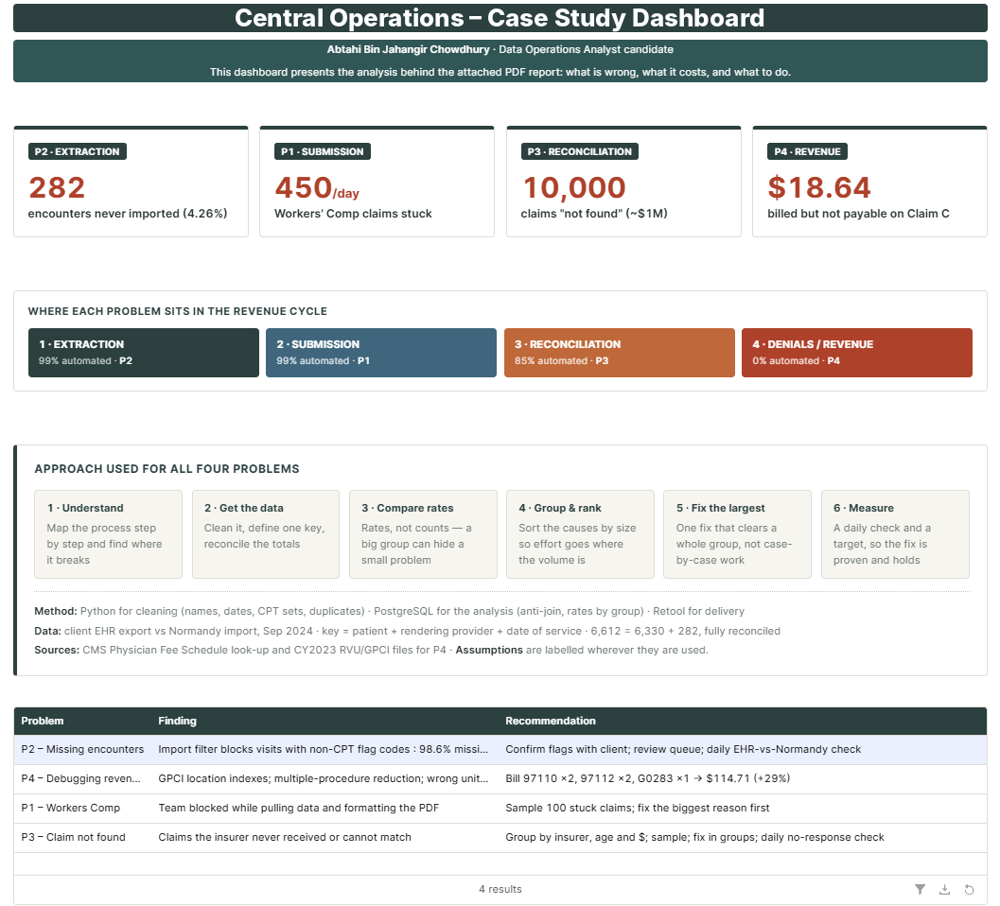
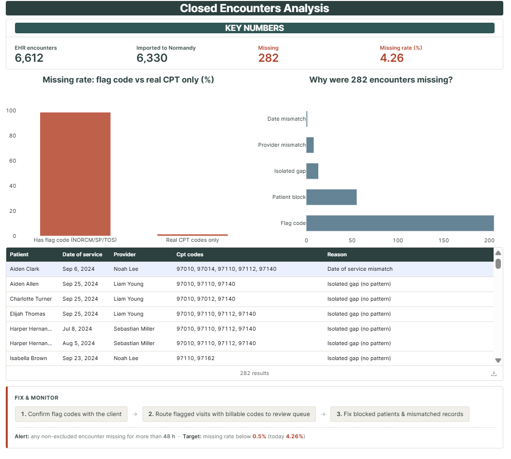
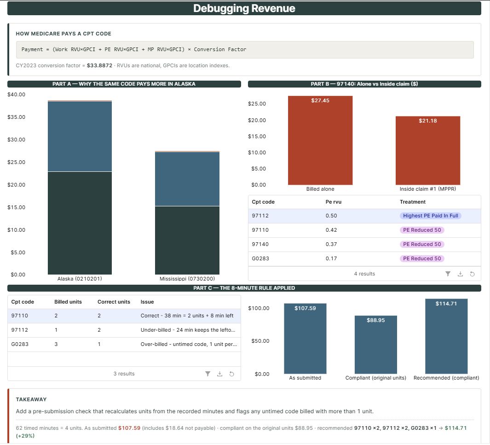
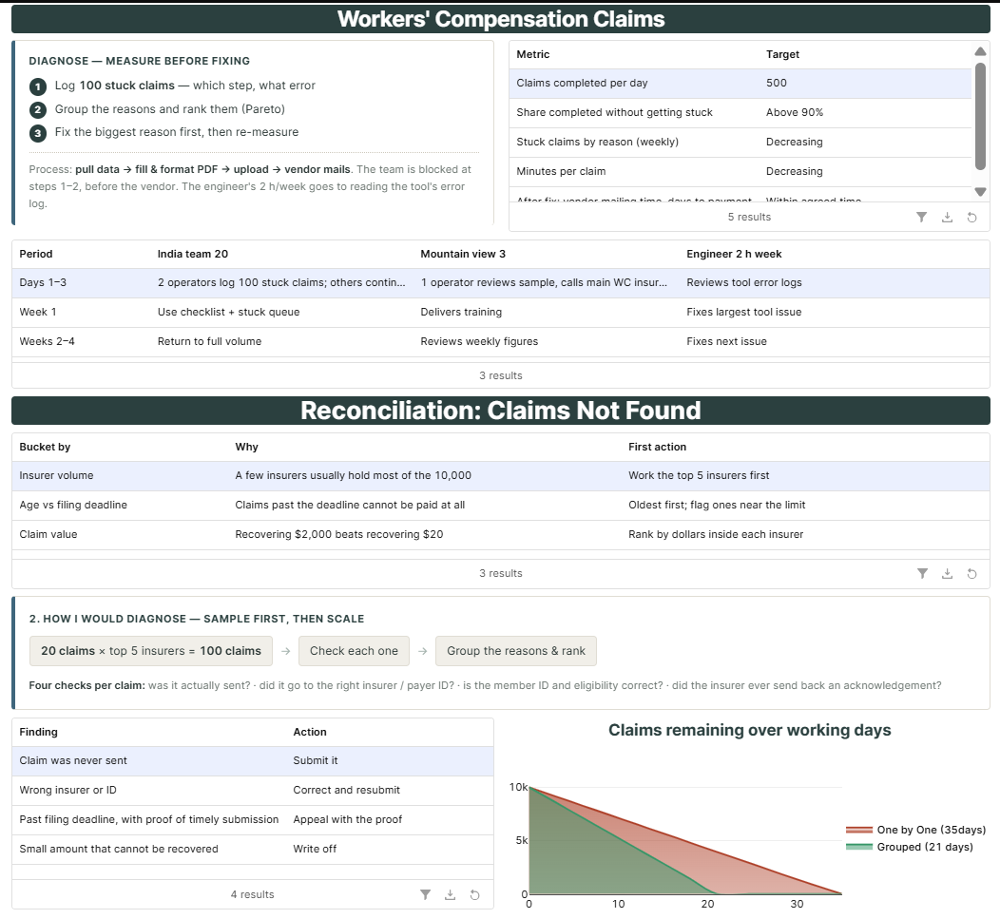

# Healthcare RCM – Data Operations Case Study

Take-home case study for a **Data Operations Analyst** role at a healthcare revenue cycle company (September 2026).
I solved four Revenue Cycle Management (RCM) problems with **Python** for cleaning, **PostgreSQL** for the analysis and **Retool** for the dashboard. I learned the healthcare billing rules (CPT codes, Medicare fee schedule, the 8-minute rule) during the assessment.

📄 **Full write-up:** [report/Case_Study_Solution_Report.pdf](report/Case_Study_Solution_Report.pdf) (9 pages)



## Results at a glance

| Problem | RCM stage | Finding | Recommendation |
|---|---|---|---|
| **P2 – Missing encounters** | Extraction | 282 of 6,612 encounters (4.26%) were never imported. Visits that contain non-CPT flag codes (NORCM, SP, TOS) are missing **98.6%** of the time, versus **1.2%** for normal visits, so an import filter is blocking them. | Confirm the flag codes with the client, send flagged visits that also have billable codes to a review queue, and run a daily EHR-vs-database check. |
| **P4 – Debugging revenue** | Denials / revenue | (A) Location indexes (GPCI) explain why 97110 pays $38.73 in Alaska vs $27.55 in Mississippi. (B) The multiple-procedure payment reduction explains why 97140 pays less in a 4-code claim. (C) Claim C billed the wrong units. | Bill 97110 ×2, 97112 ×2, G0283 ×1 → **$114.71**, which is 29% more than a compliant version of the original claim. |
| **P1 – Workers' Comp claims** | Submission | Only 50 of 500 claims/day are completed; 450/day get stuck while the team pulls data and formats the PDF. | Sample 100 stuck claims, rank the failure reasons (Pareto), fix the largest first, and add required-field checks to the tool. |
| **P3 – "Claim not found"** | Reconciliation | 10,000 claims across 150 insurers have no payer record (~$1M, assumed). | Group by insurer, age and amount, sample to find causes, fix in groups, and add a daily "no response after 7 days" check. |

## Problem 2 method (the data analysis)

1. **Clean (Python, [notebook](notebooks/P2_Step1_Cleaning.ipynb))**: standardize column names and dates, trim whitespace, drop blank rows, explode the database's `{97110,97112}` code sets, and build one row per encounter (key = patient + provider + date of service).
2. **Reconcile (SQL)**: anti-join EHR encounters against database encounters: **6,612 = 6,330 imported + 282 missing**.
3. **Find the root cause (SQL)**: compare missing *rates* by CPT code, provider, patient, month and weekday; detect codes that appear in the EHR but never in the database.
4. **Classify every missing encounter**: flag code 205 (72.7%) · patient-level block 55 (19.5%) · isolated 13 (4.6%) · provider mismatch 8 (2.8%) · date mismatch 1 (0.4%).

## Dashboard

Built in Retool on Retool Database (PostgreSQL), with one tab per problem.

| | |
|---|---|
|  |  |
|  | |

## Repository structure

```
├── report/        Solution report (PDF)
├── dashboard/     Retool dashboard screenshots
├── notebooks/     P2_Step1_Cleaning.ipynb – Python data cleaning
├── sql/
│   ├── p2_task1_task2.sql   Problem 2 analysis (anti-join, rates, root cause)
│   ├── postgresql/          Table setup, flag-code detection, import checks
│   └── retool/              Queries and text used in the Retool app
└── results/       p2_sql_results.txt – query output
```

## Data

The case prompt and the raw EHR / database datasets belong to the company that set the assessment and are **not included** in this repository. The notebook expects them in a `Case Study/` folder next to `notebooks/`.

## Tools

Python (pandas) · PostgreSQL 16 · Retool · CMS Physician Fee Schedule (CY2023 RVU and GPCI files)

---
**Abtahi Bin Jahangir Chowdhury** · abtahichowdhury2000@gmail.com
